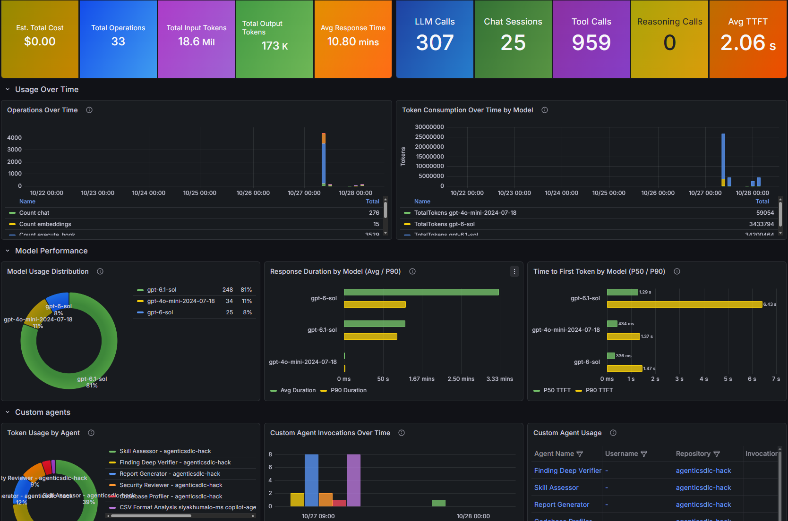

## Overview

GitHub Copilot Usage Dashboard is a reusable Azure reference implementation for
collecting OpenTelemetry from GitHub Copilot Chat in VS Code. It presents agent
activity, model and token usage, response latency, tool calls, sessions, and
geographic dimensions in Azure Managed Grafana.



> [!IMPORTANT]
> This repository provides a reference architecture, not a production security
> boundary. The default collector ingress is public and does not authenticate
> OTLP requests. Review the [security and privacy](#security-and-privacy) guidance
> before deploying beyond a controlled environment.

## Contents

* [What it provides](#what-it-provides)
* [Architecture](#architecture)
* [Quick start](#quick-start)
* [Security and privacy](#security-and-privacy)
* [Project layout](#project-layout)
* [Documentation](#documentation)
* [Common operations](#common-operations)
* [Troubleshooting](#troubleshooting)

## What It Provides

* OpenTelemetry Collector packaged as a custom container image
* OTLP/HTTP ingestion from GitHub Copilot Chat in VS Code
* Workspace-based Application Insights and Log Analytics storage
* Azure Managed Grafana dashboard with Azure Monitor queries
* KQL examples for custom-agent, token, session, latency, and location analysis
* Terraform deployment with managed identities and private Key Vault access
* Guidance for filtering, cost estimation, governance, and Power BI reporting

## Architecture

```text
VS Code with GitHub Copilot
        | OTLP/HTTP over HTTPS
        v
Azure Container Apps: OpenTelemetry Collector
        | Azure Monitor exporter
        v
Workspace-based Application Insights and Log Analytics
        | KQL through the Azure Monitor data source
        v
Azure Managed Grafana
```

The collector runs in a VNet-integrated Container Apps environment. Its
user-assigned managed identity pulls the image from Azure Container Registry and
reads the Application Insights connection string from Key Vault. Key Vault uses
a private endpoint and disables public network access. Grafana queries Azure
Monitor with its system-assigned identity.

See the [solution dataflow](docs/dataflow-diagram.md) for the complete runtime,
identity, and network flows.

## Quick Start

### Prerequisites

* Azure subscription permissions to create resources and role assignments
* Azure CLI authenticated to the target tenant and subscription
* Terraform 1.7 or later
* Docker
* VS Code with GitHub Copilot Business or Enterprise
* Permission to register the `Microsoft.App`, `Microsoft.Dashboard`, and
  `Microsoft.AlertsManagement` resource providers

For team or production deployments, configure an encrypted remote Terraform
backend before applying the infrastructure.

### 1. Authenticate and Initialize

```powershell
az login --tenant <tenant-id>
az account set --subscription <subscription-id>
$env:TF_VAR_subscription_id = az account show --query id -o tsv

az provider register --namespace Microsoft.AlertsManagement --wait
az provider register --namespace Microsoft.App --wait
az provider register --namespace Microsoft.Dashboard --wait

terraform -chdir=terraform init
terraform -chdir=terraform validate
```

### 2. Bootstrap the Registry

The collector image must exist before Container Apps can start. Create the
resource group and registry first:

```powershell
terraform -chdir=terraform apply `
  '-target=azurerm_resource_group.rg' `
  '-target=azurerm_container_registry.acr'
```

### 3. Build and Push the Collector

```powershell
$ACR = terraform -chdir=terraform output -raw acr_login_server
$ACR_NAME = $ACR.Split('.')[0]
$IMAGE_TAG = git rev-parse --short HEAD

az acr login --name $ACR_NAME
docker build -t "${ACR}/otel-collector:${IMAGE_TAG}" .
docker push "${ACR}/otel-collector:${IMAGE_TAG}"
```

### 4. Deploy the Solution

```powershell
terraform -chdir=terraform plan -var "image_tag=$IMAGE_TAG" -out=tfplan
terraform -chdir=terraform apply tfplan
```

See the [Terraform deployment guide](docs/plan.md) for configuration options,
deployment details, updates, and troubleshooting.

### 5. Configure VS Code

Get the collector endpoint:

```powershell
terraform -chdir=terraform output -raw container_app_fqdn
```

Add the endpoint to VS Code User Settings, then restart VS Code:

```json
{
  "github.copilot.chat.otel.enabled": true,
  "github.copilot.chat.otel.exporterType": "otlp-http",
  "github.copilot.chat.otel.otlpEndpoint": "https://<container-app-fqdn>"
}
```

### 6. Import the Dashboard

Install the Managed Grafana CLI extension and run the optional import stage:

```powershell
az extension add --name amg --upgrade

terraform -chdir=terraform apply `
  '-target=terraform_data.grafana_dashboard_import' `
  "-var=image_tag=$IMAGE_TAG" `
  '-var=enable_grafana_dashboard_import=true'
```

The Grafana Azure Monitor data source must use managed identity authentication.
You can also import [grafana-agent-usage-geo.json](grafana-agent-usage-geo.json)
manually.

### 7. Verify Telemetry

Use Copilot Chat, allow several minutes for ingestion, then query Application
Insights:

```kusto
dependencies
| where timestamp > ago(1h)
| summarize events = count() by bin(timestamp, 5m)
| order by timestamp desc
```

For attribute validation and reporting queries, see
[querying and reporting on telemetry](docs/querying-and-reporting.md).

## Security and Privacy

The reference deployment uses managed identities, disables ACR admin access, and
keeps Key Vault on a private endpoint. The OTLP ingestion endpoint remains public
and unauthenticated so developer workstations can reach it.

Before wider use:

* Place an authenticated gateway in front of the collector or restrict ingress
* Apply request, payload, and rate limits
* Remove the trace `debug` exporter outside bounded troubleshooting windows
* Filter or transform sensitive attributes before export
* Enable identity capture only for an approved purpose and audience
* Review Log Analytics retention and Azure RBAC assignments
* Avoid collecting prompt content, secrets, or unnecessary personal identifiers

See [filtering sensitive telemetry](docs/filtering-telemetry.md) and
[cost estimation and operations](docs/cost-and-operations.md) for implementation
guidance.

## Project Layout

* [Dockerfile](Dockerfile) builds the collector image
* [config.yaml](config.yaml) configures receivers, processors, and exporters
* [grafana-agent-usage-geo.json](grafana-agent-usage-geo.json) defines the dashboard
* [KQL-queries.txt](KQL-queries.txt) contains exploratory queries
* [terraform](terraform) contains the Azure infrastructure definition
* [wsl-setup-otel.sh](wsl-setup-otel.sh) configures a WSL session before VS Code starts
* [docs](docs) contains deployment, architecture, reporting, and operations guides
* [.github/agents](.github/agents) and [.github/skills](.github/skills) provide
  sample telemetry-generating customizations

## Documentation

### Deploy and Configure

* [Terraform deployment](docs/plan.md)
* [Manual Azure CLI setup](docs/manual-setup.md)
* [Azure Portal setup](docs/portal-setup.md)
* [Organization metadata](docs/adding-extra-metadata.md)

### Understand and Operate

* [Solution dataflow](docs/dataflow-diagram.md)
* [Querying and reporting](docs/querying-and-reporting.md)
* [Cost estimation and operations](docs/cost-and-operations.md)
* [Sensitive telemetry filtering](docs/filtering-telemetry.md)

## Common Operations

Show the deployed endpoints:

```powershell
terraform -chdir=terraform output
```

Tail collector logs:

```powershell
az containerapp logs show `
  --name copilot-dash-collector `
  --resource-group copilot-dashboard-rg `
  --tail 100
```

Deploy a new collector image by building an immutable tag and applying Terraform
with `-var "image_tag=<tag>"`. Detailed update steps are in the
[Terraform deployment guide](docs/plan.md#update).

Destroy the reference deployment:

```powershell
terraform -chdir=terraform destroy -var "image_tag=$IMAGE_TAG"
```

Key Vault soft delete can retain the vault name after destruction. This
repository does not purge soft-deleted vaults.

## Troubleshooting

* No telemetry: confirm the VS Code endpoint uses `https://` without appending
  port `4318`, restart VS Code, and inspect collector logs
* Empty panels: allow for ingestion delay, widen the dashboard time range, and
  verify the Azure Monitor data source identity
* Missing dimensions: inspect recent `customDimensions` because attribute names
  and coverage can vary by VS Code and GitHub Copilot version
* Failed dashboard import: update the `amg` extension and confirm Grafana Admin
  access for the deploying identity
* Unexpected ingestion cost: compare workspace usage with the collector `debug`
  exporter enabled and disabled
