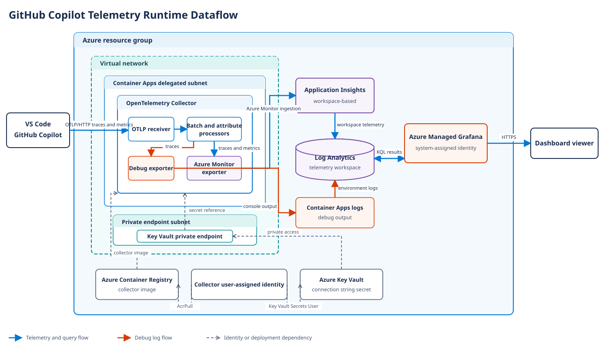

## Runtime Dataflow

Open the [editable draw.io source](dataflow.drawio) to customize the diagram.

## Key Relationships

* Azure Container Apps terminates TLS and forwards external HTTPS requests to the
  collector's OTLP/HTTP receiver on target port `4318`.
* The collector accepts OTLP/gRPC on `4317` inside the container, but that port is
  not exposed by the current Container App ingress.
* The attributes processor adds `environment=prod`; the batch processor runs
  before export.
* Traces go to both the `azure_monitor` and `debug` exporters. Metrics go only to
  `azure_monitor`.
* Application Insights is workspace-based and stores queryable telemetry in the
  Log Analytics workspace.
* Azure Managed Grafana queries Azure Monitor with its system-assigned identity.
* The collector's user-assigned identity pulls from ACR and resolves a versionless
  Key Vault secret reference.
* Key Vault public network access is disabled. Private DNS resolves the vault to
  its private endpoint from the Container Apps virtual network.

## Security Boundary

The Azure dependencies use managed identity and private Key Vault connectivity,
but the OTLP ingestion endpoint remains public and unauthenticated. Network
restrictions or an authenticated gateway are required when anonymous ingestion is
not acceptable.

## Scope

Terraform control-plane traffic, Docker image pushes, and the optional dashboard
import are deployment-time flows and are not shown as runtime paths.
